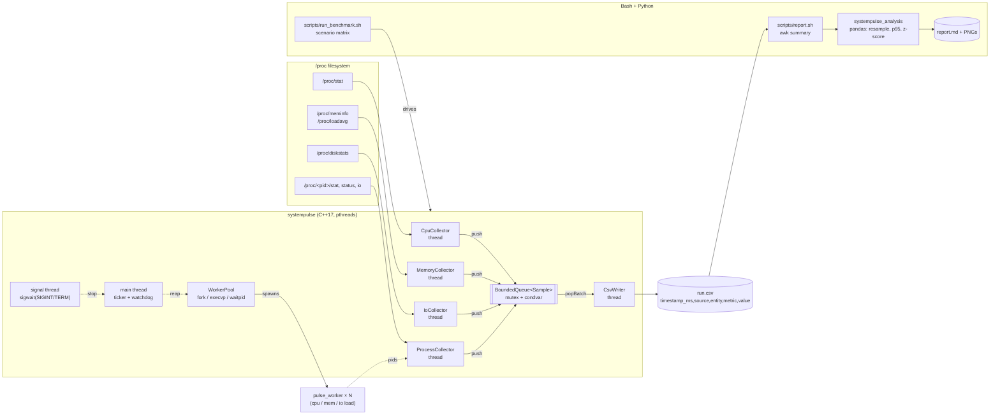

# SystemPulse

A multithreaded Linux system resource monitor written in C++17 with pthreads and POSIX APIs.
SystemPulse samples CPU, memory, and block IO by parsing the `/proc` filesystem, both
system-wide and for a set of worker processes it attaches to or spawns itself. Samples stream
to a long-format CSV. Bash scripts run benchmark matrices and produce reports, and a Python
pipeline does the time-series analysis: percentiles, resampling, anomaly detection, and plots.

## Features

- **Concurrent collectors.** Each collector (CPU, memory/load, IO, processes) runs on its own
  `pthread` with its own interval. Sleeps use `pthread_cond_timedwait` against absolute
  `CLOCK_MONOTONIC` deadlines, so the sampling interval doesn't drift.
- **Lock-protected bounded queue.** Collectors push into a mutex + condvar queue. When the
  queue is full, the oldest sample is dropped so the producers never block. A single writer
  thread drains it to CSV in batches.
- **`/proc` parsing.** Reads `/proc/stat`, `/proc/meminfo`, `/proc/diskstats`, `/proc/loadavg`,
  and `/proc/<pid>/{stat,status,io}` with raw `open`/`read`. The parsers are pure functions
  that are unit-tested against fixtures.
- **Worker processes.** Track existing PIDs (`--pid`), match them by name (`--match`), or
  spawn N workers with `fork`/`execvp` (`--spawn`). Each worker runs in its own process group,
  is reaped with `waitpid`, and is shut down with SIGTERM followed by SIGKILL.
- **Per-process metrics.** CPU %, RSS, threads, page faults/s, voluntary and involuntary
  context switches/s, disk and logical read/write bytes/s, plus totals across all workers.
- **Clean shutdown.** SIGINT and SIGTERM are blocked in every thread and handled by a
  dedicated `sigwait` thread. The queue is always fully flushed before exit.
- **Self-measurement.** At exit, each collector reports its tick count and the CPU time it
  spent, so you can see the monitor's own overhead.
- **`pulse_worker`.** A synthetic load generator with cpu, mem, io, and mixed modes and a
  configurable duty cycle, used for benchmarking.
- **Analysis pipeline.** pandas/matplotlib. Produces per-series p50/p95/p99, per-worker
  tables with RSS-growth trends, rolling z-score anomalies, CPU saturation episodes,
  comparisons across scenarios, a per-core heatmap, and a Markdown report.

## Architecture



### Threads at runtime

| Thread       | Role                                                                   |
|--------------|------------------------------------------------------------------------|
| `main`       | Spawns workers, starts everything, prints the live status line, reaps workers |
| `sp-signals` | `sigwait` on SIGINT/SIGTERM and requests a stop                        |
| `sp-cpu`     | Samples `/proc/stat` and emits total and per-core CPU %, ctx switches/s, forks/s |
| `sp-mem`     | Samples `/proc/meminfo` and `/proc/loadavg`                            |
| `sp-io`      | Samples `/proc/diskstats` and emits throughput, IOPS, util %, await, and queue depth |
| `sp-proc`    | Samples the tracked PIDs (only started when processes are tracked)     |
| `sp-writer`  | Drains the queue and appends CSV rows                                  |

You can see the threads with `ps -T -p $(pgrep systempulse)` or `top -H`.

### CSV format

```
timestamp_ms,source,entity,metric,value
1717000000123,cpu,all,busy_pct,37.5
1717000000123,cpu,cpu3,busy_pct,92.1
1717000000124,mem,system,used_pct,41.2
1717000000125,io,nvme0n1,write_bps,1.048576e+06
1717000000126,proc,pid:4242:worker-0,rss_kb,262144
1717000000126,proc,workers,cpu_pct,181.3
```

`source` is one of `cpu`, `sys`, `mem`, `load`, `io`, or `proc`. Process CPU % is measured
relative to a single core, so a process using two full cores reports 200%.

## Repository layout

```
include/systempulse/   public headers (metrics, parsers, queue, threads, collectors, monitor)
src/                   library + systempulse CLI (main.cpp)
tools/pulse_worker.cpp synthetic load generator
tests/                 C++ unit tests (self-contained harness, run via ctest)
scripts/               build.sh, run_benchmark.sh, report.sh, lib.sh
analysis/              Python package systempulse_analysis + pytest suite
implementation_plan.md phased build plan
```

## Requirements

- **Linux**, since SystemPulse reads `/proc`. Any reasonably modern kernel works; per-pid
  `io` needs kernel task IO accounting, which is on by default in most distros. The sources
  also compile on macOS for development, but the monitor can only run on Linux.
- CMake ≥ 3.14 and a C++17 compiler (GCC ≥ 8 or Clang ≥ 7).
- Bash 4+ for the scripts.
- Python ≥ 3.9 for the analysis pipeline (`pandas`, `numpy`, `matplotlib`).
- No root is needed for system-wide metrics or for processes you own. To read
  `/proc/<pid>/io` of another user's processes, you need root or `CAP_SYS_PTRACE`. Without
  it, those IO metrics are simply omitted.

No credentials, secrets, or special hardware are required.

## How to run

### Build

```bash
scripts/build.sh            # configure + build + run unit tests (build/)
scripts/build.sh --debug    # ASan/UBSan build
scripts/build.sh --tsan     # ThreadSanitizer build
```

Or build manually:

```bash
cmake -S . -B build -DCMAKE_BUILD_TYPE=Release
cmake --build build -j
```

### Monitor the system

```bash
# Sample every second until Ctrl-C, write to systempulse.csv, show a live status line
build/systempulse

# 250 ms sampling for 60 s, only nvme0n1, CSV to stdout
build/systempulse -i 250 -d 60 --devices nvme0n1 -o - -q

# Track existing processes by pid and by name
build/systempulse -p 1234,5678 -m postgres -o db.csv
```

### Spawn and monitor worker processes

```bash
# 4 mixed-load workers for 30 s; stop as soon as they all exit
build/systempulse --spawn 4 \
  --worker-cmd "build/pulse_worker --mode mixed --threads 2 --duration 30" \
  --exit-with-workers -o mixed.csv
```

Each spawned worker gets `SYSTEMPULSE_WORKER_ID` and `SYSTEMPULSE_WORKER_COUNT` in its
environment. In `mixed` mode, `pulse_worker` uses these to rotate between CPU, memory, and
IO load.

Run `build/systempulse --help` to see all options, including per-collector intervals
(`--cpu-interval` and similar), `--append`, `--no-per-core`, `--queue-capacity`, and
`--proc-root`.

### Benchmark matrix + report

```bash
scripts/run_benchmark.sh -d 30 -w 4 --report     # idle, cpu, mem, io, mixed
scripts/run_benchmark.sh -s "cpu io" -i 250      # subset, faster sampling
scripts/report.sh results/<timestamp>            # re-run the report later
```

Each run writes `results/<timestamp>/` containing:

- `host.json`
- one CSV and one log per scenario
- `report/summary.txt` (the awk summary)
- `report/report.md`, plus `summary_stats.csv`, `workers.csv`, `anomalies.csv`, and the
  `*_overview.png` / `*_per_core.png` charts

### Python analysis on its own

```bash
python3 -m venv .venv && source .venv/bin/activate
pip install -r analysis/requirements.txt
PYTHONPATH=analysis python -m systempulse_analysis cpu.csv io.csv --out report/
PYTHONPATH=analysis python -m systempulse_analysis run.csv --summary-only
```

## How to test

C++ unit tests cover the `/proc` parsers (with fixtures, including a `comm` that contains
parentheses), the CPU and disk delta math, queue concurrency (multiple producers with one
consumer, drop-oldest, close semantics), stop-signal wakeups, CSV escaping, CLI parsing, and
pid discovery against a fake `/proc` tree:

```bash
scripts/build.sh                       # builds and runs ctest
# or
cmake --build build && (cd build && ctest --output-on-failure)
build/systempulse_tests queue          # run only tests whose name contains "queue"
```

For race detection, run the tests under ThreadSanitizer with `scripts/build.sh --clean --tsan`.

Python tests generate synthetic runs, so they need neither Linux nor root:

```bash
cd analysis
pip install -r requirements.txt
pytest -q
```

To check the whole system end to end on a Linux machine, run
`scripts/run_benchmark.sh -d 10 -w 2 --report`. Then confirm that the `cpu` scenario shows
saturation episodes and that the `mem` scenario shows a positive per-worker RSS trend.
